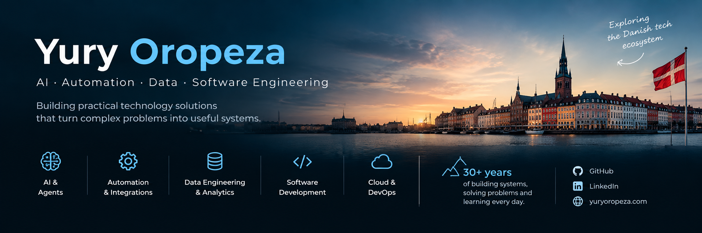

# Hi, I'm Yury 👋

### AI & Automation · Data · Software Engineering · DevOps

> **Building practical technology solutions that turn complex problems into useful systems.**

I'm a technology professional with **30+ years of experience** across software development, data, infrastructure, information systems and critical operational environments.

My career has evolved from software development and data processing to information systems, infrastructure and critical systems — and more recently towards **AI-powered applications, intelligent automation, data engineering and AI agents**.

📍 Málaga, Spain  
🇪🇺 EU Citizen  
🇩🇰 Exploring the Danish Tech Ecosystem

---

## 🚀 What I'm Building

I'm currently focused on projects that combine **software engineering, automation, data and AI** to solve practical problems.

### 🤖 AI & Intelligent Automation

- AI agents and LLM applications
- Intelligent workflows and automation
- Local-first AI experimentation
- AI-assisted software engineering
- APIs and system integration

### 📊 Data & Analytics

- Data engineering
- Python & SQL
- Data processing and transformation
- Analytics and visualization
- Data-driven decision systems

### ⚙️ Software & Infrastructure

- Software architecture
- REST APIs
- Docker & Kubernetes
- Linux
- CI/CD
- Databases
- Cloud and self-hosted infrastructure

---

# ⭐ Technologies & concepts

<p>
  
  
  
  
  
  
  
  
  
</p>

---

# 🏗️ How I Like to Build

I enjoy working across the entire path from **problem → architecture → implementation → deployment**.

```text
Problem
   ↓
Requirements
   ↓
Architecture
   ↓
Data & APIs
   ↓
Software
   ↓
Automation / AI
   ↓
Testing
   ↓
Deployment
   ↓
Monitoring & Improvement

## 🔗 Connect

[LinkedIn](https://www.linkedin.com/in/yuryoropeza/) · [Website](https://www.yuryoropeza.com/)
